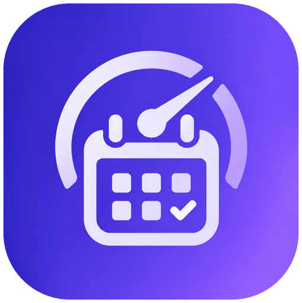

<p align="center">
  
</p>

<h1 align="center">Kalibra</h1>

<p align="center">
  <b>Ketik aja, Kalibra yang nyatet.</b><br>
  Asisten penjadwalan berbasis chat dan AI untuk mahasiswa aktif.
</p>

<p align="center">
  
  
  
</p>

---

> **English summary.** Kalibra is a chat-first scheduling assistant for busy university students. You type your plans in everyday Indonesian ("kuis Alin Kamis jam 10, deadline laprak Jumat"), the AI turns them into draft cards, you confirm, and they land in one calendar with reminders you can rely on. It started as a product-planning project at Fasilkom UI and is now being built. The rest of this README is in Bahasa Indonesia.

## Daftar isi

- [Kenapa Kalibra](#kenapa-kalibra)
- [Cara kerjanya](#cara-kerjanya)
- [Fitur](#fitur)
- [Struktur aplikasi](#struktur-aplikasi)
- [Prinsip produk](#prinsip-produk)
- [Kebutuhan non-fungsional](#kebutuhan-non-fungsional)
- [Roadmap](#roadmap)
- [Tech stack](#tech-stack)
- [Desain](#desain)
- [Dokumen produk](#dokumen-produk)
- [Pertanyaan terbuka](#pertanyaan-terbuka)
- [Tim](#tim)

## Kenapa Kalibra

Mahasiswa aktif S1 Fasilkom UI biasanya menjalani kuliah bersamaan dengan organisasi, kepanitiaan, magang, dan proyek kelompok. Informasi jadwalnya tersebar di SCeLe, grup WhatsApp, email, dan kalender yang berbeda-beda. Dari wawancara, banyak yang masih mencatat manual di chat pribadi atau grup WhatsApp diri sendiri: rawan salah ketik, tidak ada notifikasi, dan harus dicek berulang kali. Aplikasi reminder bawaan HP tidak punya tampilan kalender, dan aplikasi kalender terasa repot karena harus diisi lewat form.

Akibatnya tugas telat dikumpulkan, rapat terlupa, dan muncul stres saat jadwal tiba-tiba bentrok.

**Visi:** membantu mahasiswa aktif mengelola komitmen akademik dan nonakademik lewat asisten penjadwalan berbasis percakapan yang praktis, terpusat, dan mudah dipakai, sehingga risiko komitmen terlewat berkurang.

**Tujuan produk:**

| Tujuan | Target |
| --- | --- |
| Mengurangi kegiatan yang terlewat | Turun 50% setelah 30 hari pemakaian (dibanding baseline user) |
| Mempermudah cara mencatat jadwal | Input lewat chat bahasa sehari-hari, input suara di fase lanjutan |
| Mencegah jadwal bentrok | Deteksi bentrok dan saran waktu alternatif setelah MVP |
| Menyatukan semua jadwal | Kuliah, tugas, organisasi, magang, dan urusan pribadi di satu kalender |

## Cara kerjanya

```
"kuis alin kamis jam 10 sama deadline laprak fisdas jumat"
                     │
                     ▼
        AI mengekstrak judul, tanggal, jam, kategori
                     │
          info kurang? ──► Kalibra tanya balik (satu hal per pesan)
                     │
                     ▼
     Kartu draf (bisa diedit langsung)  ──►  user tekan Simpan
                     │
                     ▼
        Masuk Kalender + pengingat terjadwal otomatis
```

Tidak ada yang tersimpan tanpa konfirmasi user. Kalau AI gagal paham, Kalibra bilang terus terang dan menawarkan **Isi manual**.

## Fitur

Label rilis: **MVP** = closed beta Q1 2027, **v1.1** = limited launch Q2 2027, **v1.2+** = fase lanjutan.

### Fitur inti MVP (dari PRD, FR-01 s/d FR-18)

| Kelompok | Fitur | FR |
| --- | --- | --- |
| Autentikasi & profil | Daftar, masuk, keluar, edit profil, preferensi pengingat default | FR-01 – FR-05 |
| Create Schedule via Chat | Input bahasa sehari-hari, kartu draf yang bisa dikoreksi, klarifikasi info kurang, simpan setelah konfirmasi, penanganan input gagal | FR-06 – FR-10 |
| Calendar Management | Kalender terpusat (Harian, Mingguan, Bulanan), edit/hapus, jadwal berulang, kategori | FR-11 – FR-14 |
| Deadline & Reminder Management | Notifikasi pengingat, prioritas, status selesai, daftar tenggat mendatang | FR-15 – FR-18 |

### Wajib ada juga di MVP (hasil riset fitur)

Hal-hal ini belum tertulis sebagai FR di PRD tapi wajib supaya app layak rilis dan lolos store:

- **Hapus akun di dalam app** dan **kebijakan privasi** (App Store 5.1.1(v), Google Play, UU PDP No. 27/2022), termasuk persetujuan bahwa chat diproses AI.
- **Onboarding lengkap:** Welcome, kuesioner personalisasi 5 langkah, daftar dengan Google (dan Apple di iOS) atau email, lupa sandi, penjelasan izin notifikasi, tur fitur.
- **Form manual** sebagai cadangan saat AI gagal atau offline.
- **Urungkan (undo)** setelah hapus atau tandai selesai.
- **Jadwal berulang dengan pengecualian** ("hanya kejadian ini", misal libur saat UTS).
- **Acara seharian dan multi-hari**, tampilan **terlambat**, **pencarian** dan filter.
- **Notifikasi yang bisa diandalkan:** dijadwalkan lokal di perangkat, push server sebagai cadangan, tombol aksi **Tandai selesai** dan **Tunda**, ringkasan pagi, panduan mematikan optimasi baterai di Android.
- **Kalender tetap bisa dibuka offline**, perubahan disinkron belakangan tanpa duplikasi.
- **Dark mode** (Terang / Gelap / Ikuti sistem), status kosong/loading/error, aksesibilitas (teks dinamis, kontras ≥4.5:1, label screen reader, target sentuh 44 pt).
- Parsing konteks Indonesia: "besok", "lusa", "jam 3 sore", "setengah 8", WIB/WITA/WIT, format 24 jam, minggu mulai Senin, singkatan kampus (BasDat, Alin, laprak, TK, UTS/UAS, BEM).

### Fase lanjutan

| Rilis | Fitur |
| --- | --- |
| v1.1 | Edit, hapus, dan tanya jadwal lewat chat ("Besok aku ada apa aja?"), cari slot kosong, deteksi bentrok, widget layar utama, import SIAK-NG/.ics, sync Google Calendar, seret-dan-lepas, versi web, ekspor data |
| v1.2+ | Input suara, pecah tugas besar jadi sesi, subtask, integrasi deadline SCeLe, statistik mingguan, berbagi jadwal ke teman/organisasi |

## Struktur aplikasi

Mobile-first (desain dasar iPhone 390×844). Tiga tab utama, dengan Chat di tengah sebagai tombol yang menonjol:

| Area | Isi |
| --- | --- |
| **Alur masuk** | Splash → Welcome (3 slide) → Kuesioner 5 langkah → Daftar/Masuk → Izin notifikasi → Tur fitur spotlight → jadwal pertama di Chat |
| **Kalender** (tab kiri) | Tampilan Bulan / Minggu / Hari, filter kategori, detail jadwal, form tambah/edit, pencarian |
| **Chat** (tab tengah) | Percakapan, kartu draf, chip saran cepat, riwayat chat |
| **Deadline** (tab kanan) | Daftar per bagian (Terlambat, Hari ini, Besok, Minggu ini, Nanti, Selesai), geser untuk selesai/tunda |
| **Profil & Pengaturan** | Dibuka dari avatar di header. Pengaturan 8 grup: Akun, Pengingat & notifikasi, Kalender, Kategori, Tampilan, Chat & AI, Integrasi, Privasi & data |

Kategori bawaan: **Kuliah**, **Tugas**, **Organisasi**, **Magang**, **Pribadi** (warna selalu ditemani label atau ikon).

Versi web (v1.1) memakai sidebar kiri dan tata letak dua panel: kalender di kiri, chat selalu terbuka di kanan.

## Prinsip produk

1. **Chat dulu, form selalu ada.** Semua bisa dimulai dari chat, tapi setiap aksi punya jalur manual.
2. **Nggak ada yang tersimpan tanpa konfirmasi.** AI selalu menampilkan kartu draf dulu.
3. **Pengingat harus nyampe.** Notifikasi lokal jadi jalur utama, push server jadi cadangan.
4. **Kalender tetap bisa dibuka offline.** Hanya chat AI yang butuh internet.
5. **Konteks mahasiswa.** Bahasa Indonesia santai, jam 24 jam, zona WIB/WITA/WIT.

## Kebutuhan non-fungsional

| ID | Kategori | Target |
| --- | --- | --- |
| NFR-01 | Kerahasiaan data | User hanya bisa mengakses datanya sendiri, 100% akses lintas akun ditolak |
| NFR-02 | Keamanan sesi | Sesi berakhir saat logout, akses ulang wajib login |
| NFR-03 | Ketersediaan login | ≥99% login valid berhasil, respons p95 < 2 detik |
| NFR-04 | Akurasi ekstraksi chat | ≥90% sampel uji punya judul, tanggal, dan jam yang benar; yang ambigu wajib diklarifikasi |
| NFR-05 | Keandalan reminder | ≥99,9% pengingat jatuh tempo terkirim sesuai toleransi |
| NFR-06 | Konsistensi data | Perubahan/hapus tercermin di kalender, tidak ada reminder yatim |
| NFR-07 | Kemudahan penggunaan | Alur chat → konfirmasi → simpan → kalender bisa diselesaikan tanpa bantuan |
| NFR-08 | Tampilan perangkat | Berfungsi di ukuran ponsel dan desktop target tanpa elemen terpotong |
| NFR-09 | Privasi analitik | Laporan KPI hanya data agregat/anonim |
| NFR-10 | Ketahanan saat gangguan | Gagal jaringan/parsing tidak menyimpan diam-diam dan tidak bikin duplikat |

## Roadmap

| Periode | Fase | Target utama |
| --- | --- | --- |
| Q4 2026 | Perencanaan & desain | PRD, roadmap, launch plan, desain Figma, mulai pengembangan |
| Q1 2027 (Jan–Mar) | **Closed beta** | 150 mahasiswa terjangkau sosialisasi, 40 waitlist, 20 peserta beta; 70% peserta menyimpan ≥2 jadwal di minggu pertama; retensi minggu ke-4 40%; ≥90% dari 30 skenario uji lulus, nol bug kritis; 75% peserta menilai chat mudah dipakai |
| Q2 2027 (Apr–Jun) | **Limited launch** Fasilkom UI | 80 akun terdaftar, 55 menyimpan jadwal pertama; 65% akun membuka kalender tiap minggu; retensi minggu ke-4 45%; validasi harga Kalibra Pro |

**Model bisnis:** freemium. MVP gratis selama closed beta. Rencana **Kalibra Pro** (chat lanjutan, sync Google Calendar, widget lanjutan, statistik) dan paket fakultas, divalidasi lewat survei di 2027.

## Tech stack

**TBD.** Tim belum memutuskan framework mobile, backend, database, layanan notifikasi, maupun model AI yang dipakai. Bagian ini akan diisi setelah keputusan arsitektur dibuat, bersama instruksi instalasi dan cara menjalankan proyek.

Kebutuhan teknis yang perlu dijawab stack yang dipilih:

- App iOS + Android (versi web menyusul di v1.1).
- Login Google, Apple, dan email.
- Notifikasi lokal terjadwal dengan tombol aksi, plus push server sebagai cadangan.
- Penyimpanan lokal untuk mode offline dan antrean sinkron.
- Layanan AI untuk ekstraksi jadwal dari Bahasa Indonesia sehari-hari.
- Crash reporting dan analitik anonim sejak closed beta.

## Desain

- **Figma:** [Kalibra (Figma)](https://www.figma.com/design/rP6ObMzzUrNJhlQtOgZXZI). Halaman "02 · Screens (MVP)" berisi 10 layar: Welcome, Masuk, Chat klarifikasi, Chat konfirmasi draf, Kalender Mingguan/Bulanan/Harian, Deadline & Pengingat, Detail jadwal, Profil & preferensi.
- **Warna brand:** gradien indigo ke ungu (`#3B2BD0` → `#9B6BFF`), latar krem `#FFF9F0`.
- **Tipografi judul:** Bricolage Grotesque.
- **Logo:** [`docs/assets/kalibra-logo.png`](docs/assets/kalibra-logo.png) (kalender + centang + speedometer).

Layar yang masih perlu ditambah di Figma: kuesioner, daftar/lupa sandi, izin notifikasi, tur fitur, form jadwal, pencarian, riwayat chat, status kosong/error/offline, pengaturan lengkap, hapus akun, dan dark mode.

## Dokumen produk

Dokumen perencanaan disusun untuk mata kuliah Perencanaan Produk Digital (PPD) dan belum disimpan di repo ini:

- **Product Requirements Document (PRD):** latar belakang, persona, KPI fitur, analisis MVP, user stories, FR/NFR.
- **Product Roadmap:** OKR per kuartal Q1–Q2 2027.
- **Product Launch Plan:** riset pasar, analisis kompetitor (WhatsApp, Apple Reminders, Google Calendar, Notion), positioning, kanal distribusi, model bisnis, KPI peluncuran.
- **Spesifikasi lengkap aplikasi:** detail setiap layar, perilaku, dan status khusus di luar MVP.
- **Riset fitur wajib:** gap fitur table-stakes dibanding PRD dan Figma.

## Pertanyaan terbuka

- Harga Kalibra Pro: Rp19.900/bulan (Launch Plan) atau Rp15.000/bulan (Laporan Individu)?
- Closed beta khusus email `@ui.ac.id` atau terbuka untuk semua email?
- Versi web dibangun bersamaan dengan app mobile atau setelah limited launch?
- Pilihan tech stack (lihat [Tech stack](#tech-stack)).

## Tim

**Kelompok 11** · Perencanaan Produk Digital · Fakultas Ilmu Komputer, Universitas Indonesia · 2026/2027

- Ahmad Fauzan Al Ayubi
- Andy Aulia Akbar
- Jihan Andita Kresnaputri
- Mahesa Gerrardybhumi
